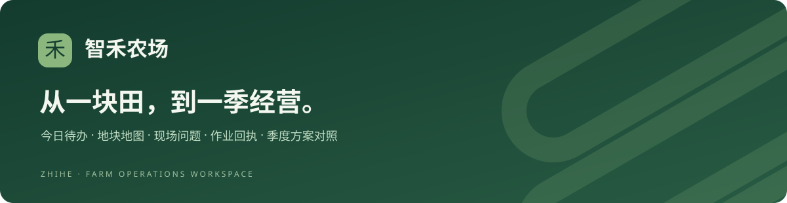
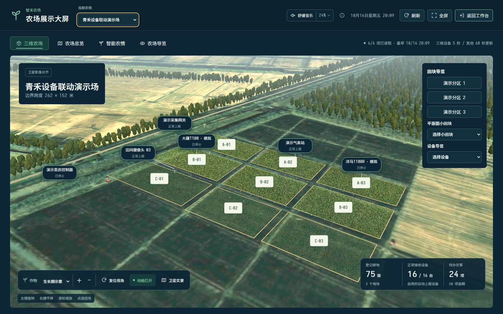
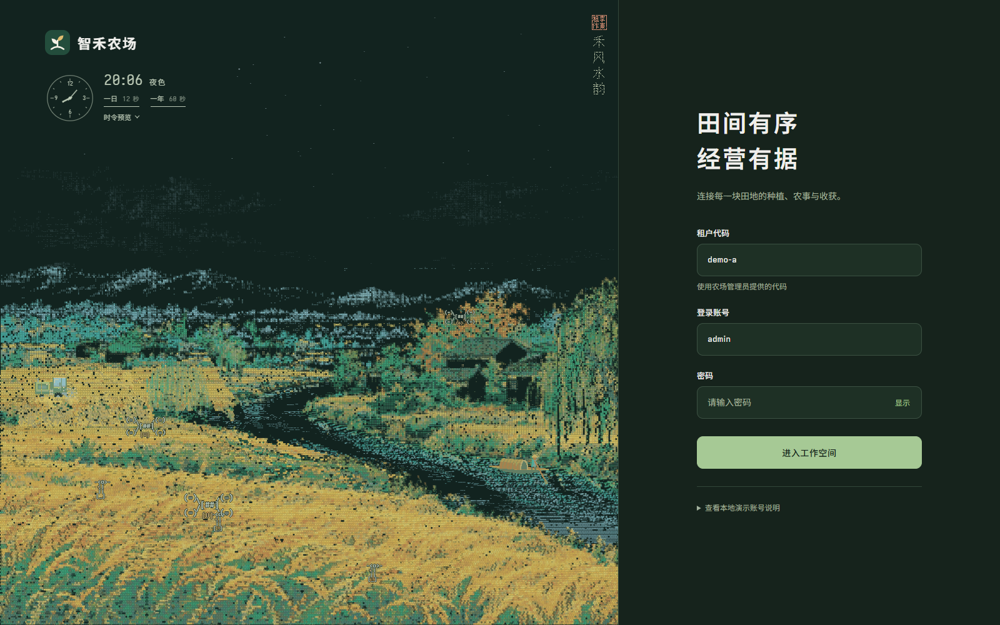
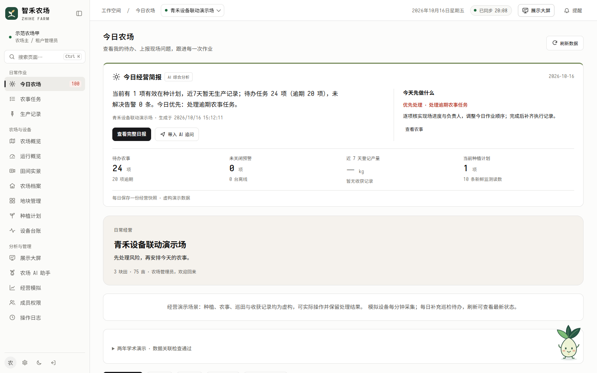
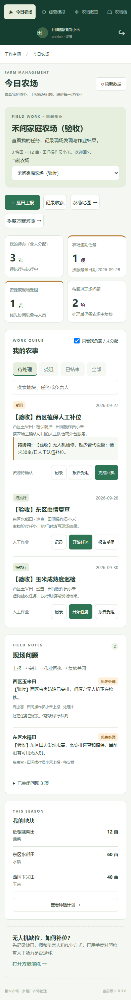

<p align="center">
  
</p>

<p align="center">
  <a href="https://github.com/Waker-visual/zhinong-platform/actions/workflows/verify.yml"></a>
  
  
  
  
</p>

<p align="center">
  面向个人与家庭农场的经营工作空间，连接田块、农事、设备与每一次作业记录。
</p>

<p align="center">
  <a href="#界面预览">界面预览</a> ·
  <a href="#快速启动">快速启动</a> ·
  <a href="#验证与开发">验证与开发</a> ·
  <a href="#文档导航">文档导航</a> ·
  <a href="CHANGELOG.md">更新记录</a>
</p>

## 项目概览

**智禾农场（Zhihe Farm）** 把日常经营、现场协作、三维展示与 AI 咨询放在同一套多租户系统中。从“今天先处理什么”到“这次作业是否完成”，每一步都关联地块、负责人和处理依据。

当前为 **0.3.0 阶段性成果版**，提供五个演示农场、桌面工作台与手机端。所有经营记录、设备状态和模拟结果均用于虚构场景展示；实体设备联调及公网生产部署尚未完成验收。

| 能力 | 可以完成什么 |
| :--- | :--- |
| **日常经营** | 维护农场、地块与种植计划，查看今日待办、经营简报和收获记录。 |
| **农事闭环** | 巡田上报 → 派发任务 → 协调资源与受阻 → 作业回执 → 现场复核。 |
| **三维与地图** | 探索 Unity WebGL 农场，定位田块与设备；切换卫星地图、经营总览、智能农情、天气预警和农场导览。 |
| **设备监测** | 查看气象、墒情、水情与虫情，区分缺测和过期读数；支持模拟控制及 HTTP 上报、指令回执接口。 |
| **智能农情大屏** | 与天气预警保持统一风格，集中核对当前关键指标、四情诊断、近7天土壤水分走势与生产建议；详细依据按需展开，手机自然纵向阅读，实时监测与日报快照分别标时。 |
| **天气与预警** | 在“展示大屏 → 天气预警”同屏核对七日公开区域预报与重点预警，手机可横滑日期；高温、低温、降水、阵风、雷暴和降温线索与设备、现场问题分来源跟进，保留证据与人工行动入口。 |
| **数据核对** | 统一产量窗口与读数口径；管理员可在运行概览核对关联、回执和疑似重复，按记录定位并人工更正。 |
| **AI 小禾** | 结合当前农场与页面资料流式回答；墒情决策卡保留证据，管理员确认后派发巡查任务，完成后复测复核。模型失败时明确回退规则。 |
| **经营模拟** | 对照季度资源方案，观察巡检、灌溉与农机缺位的影响，保留参数、事件和模拟记录。 |

## 界面预览

### 三维农场大屏



田块编号与设备热点联动当前农场记录，支持旋转、平移、缩放、设备演示动画和可选舒缓音乐。卫星影像来源：Esri、Vantor、Earthstar Geographics、GIS User Community；影像及模型不代表实时画面或测绘成果。

<details>
<summary><strong>展开查看登录场景、经营工作台与手机协作</strong></summary>



<p align="center">
  
</p>

<p align="center">
  
</p>

登录页提供昼夜、四季与节日场景预览。工作台按角色组织任务，手机端支持巡田上报、受阻反馈与完成回执；更多流程见[单农场场景与验收指南](docs/单农场场景与验收指南.md)。

</details>

## 快速启动

准备 **Windows PowerShell、JDK 21+、Maven 3.9+、Node.js 22.12+**。

**需要查看 3D？请在首次启动前准备 WebGL 资源。** Git 仓库不包含编译后的 Unity 二进制文件。按 [WebGL 开发包指南](docs/WebGL开发包使用指南.md)下载、校验并解压预编译包，再执行启动命令，无需安装 Unity。预编译包的场景效果以其发布版本为准；最新模型行为需使用对应版本重新构建。管理、地图和 AI 模块可独立运行。

```powershell
git clone https://github.com/Waker-visual/zhinong-platform.git
Set-Location zhinong-platform
powershell.exe -NoProfile -ExecutionPolicy Bypass -File .\scripts\start-demo.ps1
```

首次运行会安装依赖、构建前后端并初始化演示数据。打开 **http://127.0.0.1:9175**，以租户 `demo-a`、账号 `admin` 登录；随机初始密码由终端输出，并保存在本机 `.cache/demo-password.txt`。保持终端运行，按 `Ctrl+C` 停止。

<details>
<summary><strong>常用启动与配置</strong></summary>

- **再次启动**：代码与资源未变化时执行 `.\scripts\start-demo.ps1 -SkipBuild`；更新后先停止旧服务，再重新构建。
- **保留历史、只恢复推流**：设置 `FARM_DEMO_STREAM_ENABLED=true` 和 `FARM_DEMO_STREAM_LIVE_ONLY=true`，同时关闭所有演示生成与历史清理开关，沿用现有数据库和私有配置启动；该模式只追加当前模拟读数，启动、跨日与断流后均不补历史。请按[仅恢复实时遥测](docs/完整经营演示指南.md#保留现有数据只恢复实时遥测)操作，不使用完整演示启动脚本。
- **前端开发**：后端运行时，执行 `npm.cmd --prefix frontend ci` 和 `npm.cmd --prefix frontend run dev`，访问 `http://127.0.0.1:4273`。
- **模型服务**：将 `config/llm.example.properties` 复制到 `backend/config/llm.properties`，在私有文件中填写 OpenAI 兼容服务参数。支持 DeepSeek；未配置或调用失败时明确显示规则回退。见[小禾使用说明](docs/农场AI助手使用说明.md)。
- **数据库**：默认使用本地 H2；核心业务接入 MySQL / 云库使用 `scripts/start-cloud.ps1`，填写私有 `config/database.properties`。独立经营模拟库另行配置，见[数据库指南](docs/云数据库接入与学术数据说明.md)。
- **演示角色**：`demo-a` / `demo-b` 提供 `admin`、`operator`、`viewer`；平台管理使用租户 `platform`、账号 `platform`。初始演示密码相同，修改后以各账号实际密码为准。

数据库、模型密钥和本地口令均由 Git 忽略，发布时使用空白配置模板。

</details>

## 架构与权限

| 层次 | 技术与职责 |
| :--- | :--- |
| 界面 | Vue 3、Vite、Leaflet、ECharts；桌面与手机页面共用业务接口。 |
| 三维 | Unity 6000.6.5f1 / WebGL 2 场景，Three.js 农场导览；按需加载。 |
| 服务 | Spring Boot 4.1.1、Java 21+、JDBC；农事、监测、模拟与 SSE 模型网关。 |
| 存储 | H2 本地演示 / MySQL 核心业务；支持独立经营模拟库。 |
| 工程 | PowerShell 启动与验证、GitHub Actions、Android 原生容器。 |

租户由已认证会话确定，业务查询、关联与写入均校验租户。农场主负责安排与复核，操作员处理授权任务，查看者只读；平台账号管理租户，不读取其经营数据。同租户的查看范围覆盖整个租户，任务负责人限制属于执行权限。

## 验证与开发

在仓库根目录执行：

```powershell
npm.cmd --prefix frontend ci
.\scripts\verify.ps1
```

统一验证包括后端测试、UTC 业务日历回归、前端测试与生产构建、包体与字体检查、Android 地址校验、敏感信息扫描和 MySQL 表结构一致性。主分支推送与 PR 运行[同一套 CI](https://github.com/Waker-visual/zhinong-platform/actions/workflows/verify.yml)。

配置本机独立 MySQL 环境后，可另运行 `scripts/verify-mysql.ps1`；小禾浏览器验收使用 `node tools/test_floating_assistant.cjs`，在一次性内存库中检查流式回答、重试、拖动、农场切换隔离及手机布局。当前阶段的改动与验证记录见 [CHANGELOG](CHANGELOG.md)。

```text
backend/    业务 API、鉴权、设备协议、AI 网关与经营模拟
frontend/   桌面工作台、手机页面、地图和大屏
unity/      WebGL 场景工程
android/    智禾随行原生容器
scripts/    启动、构建、数据库准备与统一验证
tools/      回归验收与项目检查
docs/       使用指南、资产来源与展示截图
```

## 文档导航

| 主题 | 入口 |
| :--- | :--- |
| 日常经营与协作 | [场景与验收](docs/单农场场景与验收指南.md) · [地图与作业](docs/单农场地图与作业指南.md) |
| 三维展示 | [大屏与操作](docs/展示大屏使用指南.md) · [七日天气与农情预警](docs/七日天气与农情预警使用说明.md) · [WebGL 开发包](docs/WebGL开发包使用指南.md) · [场景资产来源](docs/WebGL资产来源说明.md) |
| AI 小禾 | [对话、来源记录与模型配置](docs/农场AI助手使用说明.md) |
| 决策闭环与评测 | [证据、派工与复核](docs/证据化AI决策闭环使用说明.md) · [真实模型评测](docs/AI决策评测指南.md) |
| 设备接入 | [接口说明](docs/设备接入接口.md) · [现场验收](docs/smart-farm设备接入与现场验收.md) |
| 数据与模拟 | [数据链路与统计口径](docs/数据链路与统计口径说明.md) · [数据库与演示数据](docs/云数据库接入与学术数据说明.md) · [经营模拟](docs/账号地图与经营模拟指南.md) |
| 移动端 | [智禾随行 Android](docs/智禾随行Android使用指南.md) |
| 工程维护 | [架构](docs/架构与改造说明.md) · [稳定性与性能](docs/服务稳定性与性能指南.md) · [升级与回退](docs/设备校准与控制验收.md) |

## 数据与授权

本项目仅使用虚构经营数据。经营模拟基于明确假设及公开再分析天气，不是产量预测或生产处方；AI 建议需要人工核查，聊天不会直接控制设备。

仓库公开源码用于展示，**尚未为业务源码授予开源许可证**。第三方依赖、字体、地图、天气及部分场景资产保留各自版权、许可和署名；Unity 场景的分发依据与资产范围见[场景资产来源](docs/WebGL资产来源说明.md)，其余见[依赖与权属说明](docs/依赖与权属说明.md)。公开展示不改变实际合作或委托协议中的权利关系。
