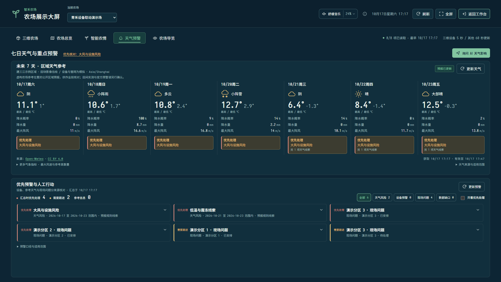

# 七日天气与农情预警使用说明

## 查看七日天气

登录农场账号，进入 **展示大屏 → 天气预警**。这是与“智能农情”并列的独立大屏，上方横排今日起7个农场自然日的天气预报，下方集中显示重点预警与筛选入口。桌面布局按窗口高度收紧留白，尽量同屏核对天气和重点事项；较长的预警列表与展开依据可在区域内滚动。

手机使用自然纵向布局，七日天气日期带可横滑，向左滑动可查看较后日期。更矮的窗口或浏览器放大时允许整页纵向滚动，保留文字与操作按钮；不会为了塞进一屏而裁掉内容。

“智能农情”保留当前有效测点、四情分析、历史水分走势和日报建议。通过顶部页签切换，两页沿用当前农场；七日天气和综合预警只在天气预警页集中展示。

每日展示天气文字、高低温、降水概率、降水量和阵风；展开“更多气象指标”可核对七日最大风速和参考蒸散量 ET₀，“天气来源与适用范围”可展开查看完整说明。来源署名、获取时间和有效期持续显示。缺测用“—”，真实0保留；降水概率不等于降水量，ET₀是参考条件下的蒸散量，不是作物灌溉量。点击某日可核对该日命中的天气风险；非连续日期不会被当作连续风险区间。

天气来自 [Open-Meteo公开预报接口](https://open-meteo.com/en/docs)，使用农场**已保存的地图参考中心**。管理员可在“农场概览”的位置校准中保存中心。地图尚未保存时，即使底图显示了默认示例位置，也不会偷偷使用该示例坐标取得天气。

经营记录与设备仍为虚构演示数据；外部天气是参考区域的公开网格预报，不是虚构农场的真实生产观测、棚内温度或官方灾害预警。位置标签、坐标、来源、获取时间和有效期均可核对。“获取时间”不是气象模型发布时间，接口没有提供的发布时间不自行编造。

上图为2026-10-17紧凑布局的1920×1080验收快照，七日天气与重点预警同屏展示；图中为当时取得的公开预报和虚构经营问题，不是阅读说明时的当前预报。

## 使用综合预警

预警分为天气风险、设备异常、现场问题、资料缺口，可按来源和优先级筛选，展开查看具体日期、数值或事件依据。桌面预警区域保留独立滚动，展开详情后可继续在该区域查看其余事项。每项给出人工核查建议，并提供查看天气、进入预警中心、跟进农事或带入 AI 追问的入口。

| 天气筛查 | 本版教学阈值 | 用途 |
| --- | --- | --- |
| 高温 | 日最高温≥35℃ | 提醒核查露天作业时段、防暑和设施通风 |
| 低温/霜冻线索 | 日最低温≤0℃ | 提醒核查作物耐寒性、保温与官方预警 |
| 强降水 | 日降水量≥25mm | 提醒检查排水与低洼区，不认定已经积水 |
| 大风 | 日最大阵风≥10m/s | 提醒核查设施和作业条件，不代替无人机或农机操作规程 |
| 雷暴 | WMO天气码95/96/99 | 提醒关注官方信息和露天、电气作业条件 |
| 明显降温 | 相邻两日最高温下降≥8℃ | 提醒核查保温，不直接判定冻害 |

这些规则是透明的通用筛查，版本为 `weather-screen-v1`；没有针对某品种、生育期、土壤或设施作校准，不能作为农艺处方。远期预报存在变化，执行前仍需复核更新后的预报和现场情况。

设备告警转成未关闭现场问题后，在综合列表中合并到该现场问题，保留关联告警数量和最高优先级；预警中心的原告警仍保留，不会因合并显示自动关闭。现场问题关闭而原告警尚未解决时，原告警恢复为独立设备项。已知晓不等于已解决。

高优先级事件先排序再截取明细，旧的严重告警不会被大量近期普通告警挤出。总数按全部符合条件的事件计算，最多展示80项；达到上限有明确提示。资料缺口也单独计数，不能把“没有触发风险”解读成没有风险。

风险页面只读，不自动创建问题、派工、施药或下发设备指令。查看者可读，后续处理仍遵循原业务权限和确认流程。AI 新增独立“未来七日天气预报”只读工具，历史观测工具与未来预报分开；工具使用会话绑定农场，不接受模型指定另一农场。

## 更新、失败与配置

天气和风险分别加载，外部天气连接慢不会阻止其它大屏资料显示。切换农场时清空旧资料；隐藏或关闭大屏会取消浏览器请求。天气过期或跨农场自然日会标为旧资料，旧天气风险不继续作为当前判断。

服务缓存30分钟，同农场相同位置的并发请求合并；失败退避2分钟，最多保留6小时内的旧预报并明确标旧。刷新按钮重新检查服务可用数据，不会每次都请求上游。超过保留期直接显示不可用，不用历史观测、模拟数值或补零代替预报。位置重新保存后即失效旧缓存。

默认启用公开天气服务。设置环境变量 `FARM_WEATHER_ENABLED=false`（或 `farm.weather.enabled=false`）可关闭；关闭后其它经营和监测功能可继续使用。外部请求固定发往 `https://api.open-meteo.com/v1/forecast`，只发送坐标、时区与固定气象字段，不发送租户、账号、农场名称、作物或经营台账。

请求连接最多3秒，完整响应最多6秒；响应体上限128KiB，缓存最多128个范围。需要网络可达；使用系统代理的本机环境，可沿用项目启动脚本的系统代理选项。网络不可达时请稍后重试并查看当地官方气象信息。

Open-Meteo天气数据按 [CC BY 4.0](https://creativecommons.org/licenses/by/4.0/)署名使用，本项目转换天气文字、选择日期并另行计算筛查规则。界面保留来源与许可证链接，发布包包含 `/licenses/open-meteo-data-NOTICE.txt`。[免费托管接口条款](https://open-meteo.com/en/terms)适用于非商业原型；商业部署和调用容量需按提供方当前方案另行配置，数据许可不等于免费商业托管许可。

升级时先正常停止旧服务，再使用当前源码重新构建并运行；旧进程不会自动获得新天气接口与前端。新功能没有增加数据库表或改写历史业务记录。

## 本轮验证（2026-10-17）

完整 `scripts/verify.ps1` 通过：后端默认测试293项实际通过、22项MySQL按环境跳过，独立UTC回归10项通过；另行连接本地MySQL执行22项，全部通过。后端合计325项实际执行通过。前端352项与项目工具39项通过，生产构建、包体、字体、Android与项目公开范围检查通过。

新增验证覆盖租户隔离、平台账号拒绝访问、未保存位置不请求上游、并发合并、位置变更、跨日、过期、缓存上限、网络超时、异常响应、单位校验、真实0与缺测，以及风险阈值、告警合并、全量计数和严重度排序。真实公开接口及应用接口均取得过完整七日预报；浏览器验收覆盖1920、1366与390宽度、筛选、证据展开和处理入口，并用受控响应检查未配置位置、断网保留旧值等状态。测试没有调用真实云端模型，工具接入验证不等于模型回答质量评测。
