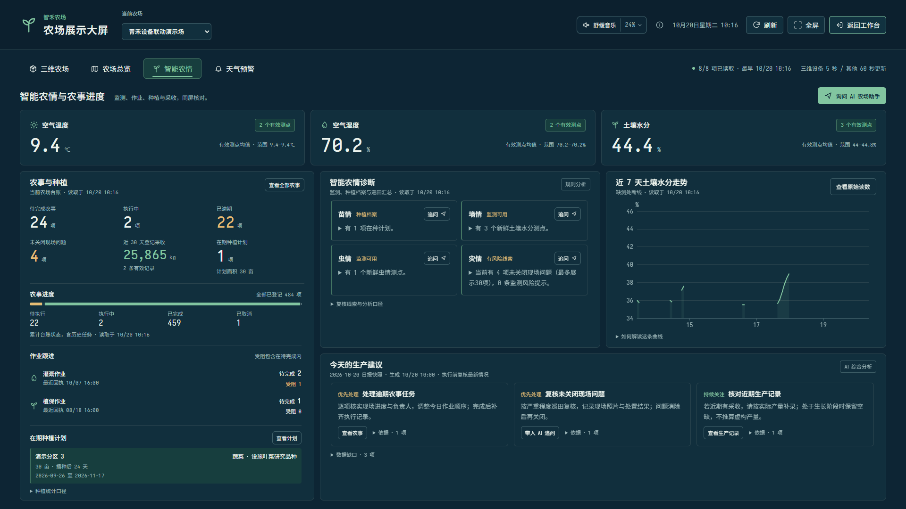

# 展示大屏使用指南

## 进入与操作

以农场管理员、操作员或查看者登录，点击顶部“展示大屏”，或在左侧“分析与管理”中选择“展示大屏”。窄屏顶部使用显示器图标，也可以通过“更多”搜索该入口。平台管理员没有经营大屏入口。

大屏沿用当前选择的农场，可在窗口内切换。切换时取消上一农场尚未完成的请求，清空旧展示并重新取数；即使旧请求随后返回，也不会覆盖新农场。退出后业务工作空间沿用新选农场。无需另建账号，也不把会话放入 URL。

- **三维农场**：默认进入精细田间场景，按当前农场已保存的边界和设备位置呈现空间分布；可点选田块、切换作物示意外观、返回卫星实景。
- **农场总览**：在卫星影像上查看田块边界与设备位置，并核对农场规模、近 30 天采收分布、作业进度和当前风险。采收分布可直接进入“生产台账”。
- **智能农情**：与天气预警使用统一的紧凑卡片风格，集中查看关键指标、四情诊断、近7天土壤水分走势、“农事与种植”及生产建议。农事面板核对待完成、执行中、逾期、现场问题、灌溉植保进度、在期种植与近30天采收登记。摘要与时效优先显示，详细依据、现场复核线索、阈值说明与数据缺口按需展开；监测标出采样时效，日报单独标记生成时间和冻结快照。
- **天气预警**：上方横排今日起7日区域天气，下方查看重点预警、筛选与人工行动；常见桌面尺寸尽量在同一屏内核对，预警明细和展开依据在区域内滚动。更多气象指标与来源按需展开；手机可横滑七日日期带，整页自然纵向阅读。操作见[七日天气与农情预警](七日天气与农情预警使用说明.md)，与智能农情通过顶部页签切换。
- **全屏**：由按钮请求浏览器全屏。浏览器不支持或拒绝时，仍可使用铺满窗口的大屏布局；退出按钮返回原工作空间，Esc 遵循浏览器退出全屏与关闭窗口的行为。
- **展示尺寸**：农场总览在1920×1080和1366×768桌面布局中以左侧卫星地图为主体，右侧排列经营研判、采收分布和待跟进事项。智能农情与天气预警按窗口高度收紧留白，尽量同屏保留各自的关键内容；较长明细在各自区域内滚动。更矮的窗口允许整页纵向滚动，保留卡片可读高度。平板地图独占一行，手机使用自然纵向排布。
- **继续处理**：通过设备、农事、预警或询问 AI 入口回到业务页面。询问 AI 仅带入问题，由用户发送；确认预警沿用原有页面；三维设备控制沿用既有角色权限和确认流程。
- **动态展示**：打开大屏时整体淡入，切换视图时内容平滑显现，历史图表从时间轴左侧展开；页签和按钮响应点击，状态点短暂呈现涟漪后停止。不会自动翻页、自行启动巡游或让读数虚假跳动。3D 页签可手动开启环绕巡游，也可单独关闭场景动态。在操作系统或浏览器开启“减少动态效果”后，这些展示动效关闭。

大屏的农场资料、运行趋势、智能农情、每日简报、地图定位、田块边界、七日预报与风险分别请求，哪一项先返回就先显示，不再等待最慢的一项才能更新整屏。状态栏显示已读取的项目数和其中最早的读取时间，悬停可查看各项读取时间；日报生成时间仍单独保留。

大屏每 60 秒尝试更新，上一批未完成时不叠加请求；也可以点击顶部“刷新”。某项更新失败时保留同一农场上次成功读取的内容，并明确标出“保留快照”和原读取时间；从未成功读取的模块保持缺失状态，不补零，也不把旧快照标成最新数据。提示区的“重试失败项”只重新请求失败模块。身份失效或无权访问时清除相应数据，不继续展示无权读取的快照。

隐藏页面会取消正在进行的数据请求并暂停自动更新，恢复可见后重新读取；关闭窗口会取消请求并清理定时器。地图瓦片与这些业务数据分别加载，影像连接较慢时仍可查看已经返回的经营与农情内容。

## 智能农情

在顶部切换到“智能农情”。先看关键监测指标的有效测点数与缺测提示，再结合苗情、墒情、虫情、灾情的状态和诊断摘要核对情况。摘要摘自原诊断的第一句话，点击可展开完整诊断与建议；标题旁的“追问”会带入完整内容。近7天走势来自已有土壤水分采样，缺口保持断线，可通过“查看原始读数”进入设备页面。

“农事与种植”展示当前农场的全量待完成、执行中、逾期农事和未关闭现场问题，并列出全部已登记农事的状态分布。执行中与逾期属于待完成农事的子集，不应相加作为总量。灌溉、植保分别展示待完成及其中受阻的数量，并保留最近回执；近30天采收同时展示登记产量和记录条数。在期种植计划显示登记作物、面积、计划日期和播种后天数，列表最多展示前3项，超出时提示其余数量。农事汇总采用接口返回的完整统计，不由截断的任务明细推算总数；没有记录、缺失数据和有效零值分别呈现。

桌面在关键指标、四情与走势、生产建议之外同屏安排农事面板，建议卡片按实际1至4条铺满可用宽度。详细依据、需现场复核的线索、阈值说明和资料缺口可展开查看；内容较长时在面板内继续阅读。屏幕过矮或浏览器放大后改为自然纵向排布，不以裁掉内容强行保持一屏。手机按阅读顺序向下查看，卡片根据可用宽度重排，保留展开、追问与业务跳转入口。

生产建议来自已保存的当日日报，生成时间与“冻结快照”提示持续保留；日报中的证据和计数反映生成时刻，不因当前指标已经更新而自动改写。需先核对现场及当前监测，再按原权限进入农事、种植或生产页面处理。收起详情只改变显示状态，不修改数据、不重新生成日报。

本次布局调整沿用原有数据接口、刷新周期与实时采集配置，不要求重新初始化农场或清理历史。保留历史的推流仍只追加当前模拟读数，操作方法见[仅恢复实时遥测](完整经营演示指南.md#保留现有数据只恢复实时遥测)。

上图为2026-10-20的1920×1080验收快照，包含“农事与种植”面板。指标、诊断和走势反映当时读取的虚构演示资料；生产建议保留其日报生成时间，图中数值不代表阅读说明时的当前状态。

## 三维农场

进入大屏默认打开“三维农场”。左键拖动旋转、右键长按拖动平移、滚轮或加减按钮缩放；也可以用右侧田块导览按钮选择田块，查看资料并进入地块台账。“复位视角”恢复全景；“卫星实景”切回已有卫星总览。三维资源只在打开该视图时加载，首次下载会显示进度，失败可重试或使用卫星视图。

田块和监测点使用当前账号已获授权的农场数据，通过同源消息送入场景，不把账号、会话、设备密钥或经营资料写入静态模型。切换农场会销毁上一场景。没有有效边界时不生成虚构田块。“苗期 / 生长期 / 成熟期”仅改变示意外观，不代表真实作物、播种时间或监测结果。周围地形、树带、农机、温室和粮仓为场景示意资产，不能作为实景重建或测绘依据。

三维源工程位于 `unity/FarmScene`，使用 Unity 6000.6.5f1 与 Web 构建模块。运行 `scripts/build-farm-scene.ps1 -UnityCli '<本机 CLI 路径>'`，再执行正常前端与后端构建。生成文件位于 `frontend/public/farm-scene/Build`，不入 Git；发布前必须生成并随前端一起打包。浏览器需支持 WebGL 2。Unity 生成缓存、私有参考包均不提交。

未安装 Unity 时，可直接使用维护者提供的完整 WebGL Build 包；下载、文件校验及解压后构建步骤见 [WebGL开发包使用指南](WebGL开发包使用指南.md)。开发包通过 GitHub Release 分发，不需要协作者重新提取参考模型。

## 卫星地图

农场总览使用 Esri World Imagery 在线卫星影像作为底图，通过项目已有鉴权瓦片接口加载。底图保留来源署名与比例尺；影像不是实时航拍，其拍摄时间和清晰度由影像提供方决定。需要网络可达，加载中、连接慢、部分缺失或加载失败都有状态提示；失败时可重试，不用离线矩形图冒充卫星图。

首次加载未缓存的影像可能比刷新慢。连接超过 6 秒会提示稍候；每个影像源最多等待 12 秒，卫星主源失败后会尝试备用源，浏览器为整张瓦片保留最多 30 秒。等待或重试期间可继续查看已加载的区域；切换农场、关闭大屏会取消不再需要的浏览器请求。

使用地图上的缩放按钮或“复位视野”调整范围，点击田块查看资料，点击设备进入详情。田块也可用键盘选择；范围较大、名称可能重叠时，标签改为悬停或聚焦显示，放大后自动展开。地图只在这些操作时进行视野过渡，不会自行移走当前查看的位置；减少动态效果设置同样适用于地图过渡。

地图优先展示已保存的 WGS84 估绘田块边界；没有估绘边界的田块沿用地图配置中的登记轮廓。设备位置来自已保存 GPS 或按地图配置转换的本地坐标，缺失位置的设备不会随机放到地图上。田块边界是人工估绘与演示登记信息，未经过实测确权，不能作为地籍或面积测量依据。

## 数据口径

农场经营、监测与田块登记仍为本项目虚构演示数据；卫星底图为影像提供方的真实地理影像。展示根据已认证用户及当前农场调用接口，服务器校验租户和农场归属。

| 展示内容 | 来源与解释 |
|---|---|
| 卫星底图与田块/设备 | Esri World Imagery 卫星影像叠加已保存的田块边界及设备安装位置；不随机放置设备。缺少边界或位置时提示未配置；登记图形与影像叠加不代表实测地籍成果。 |
| 设备状态 | 按有效设备的接收时间和采集周期判定，区分正常接收、过期和未收到数据；维护、停用、手工设备不冒充在线设备。 |
| 当前环境读数 | 仅使用来源与当前接入方式一致、采样和接收时间均有效的新鲜测点；缺测和过期显示“—”，有效零值保留。 |
| 历史趋势 | 近 7 天已有采样的时间片统计，缺口断开，不补零；历史值不代表设备当前在线。 |
| 七日天气 | 天气预警页读取已保存参考位置的公开区域网格预报；独立标记来源、获取时间、有效期与旧资料状态，不代替田间实测。 |
| 登记产量 | 选定记录窗口内的收获台账，暂无记录不等于产量为零，不推算利润。 |
| 近 30 天采收分布 | 按地块汇总登记产量（kg）；4 个以内全部展示，超过 4 个时显示产量最高的 3 个及“其他 N 块”合计。副标题统计有台账登记的日期数，并非记录条数。无记录、读取失败与已登记的零产量分别显示；缺失产量不补零。 |
| 农事与种植 | 沿用当前农场的工作区、运行概览与农情分析接口：完整汇总待完成、执行中、逾期、未关闭现场问题及全部农事状态；灌溉、植保展示待完成与受阻子集、最近回执；近30天采收展示登记产量与记录条数。在期计划只列前3项，并标出未展示数量；播种后天数按登记日期计算，不代表作物实测生育期。 |
| 预警 | 读取后台监测已保存的告警，包括未恢复的已确认预警。后台默认每 60 秒巡检，设备接收路径也会更新监测状态；大屏读取本身不再触发全场扫描写入，可进入预警中心即时核查。明细返回上限为 200 条，达到上限以“200+”提示。 |
| 综合风险 | 天气预警页合并展示天气风险、设备异常、现场问题与资料缺口；关联告警合并跟进，全量计数，明细最多80项，高优先级先展示。筛选和展开不会更改原告警或现场问题。 |
| 今日建议 | 已保存的日报快照，标出生成时间与“AI 综合分析”或“规则分析”；与实时监测分开展示。 |
| 数据与能力缺口 | 展示缺少新鲜测量、种植资料、天气预报、销售及成本等限制，帮助判断建议是否有足够依据。 |

业务数据使用当前农场下的 `workspace?days=30`、`operations?hours=168`、`ai/analysis`、`ai/briefings/today`、`map-config`、只读 `field-map`、`weather-forecast` 和 `risk-overview` 接口；卫星瓦片使用 `/api/map-tiles/SATELLITE`。视图切换复用同一农场的资料，不把七日天气与综合风险重复放回智能农情。当日简报首次读取仍遵循原有按农场/日期幂等生成逻辑，刷新不会另建聊天或重复生成同日报告。

## 验证方式

项目根目录运行 `scripts/verify.ps1`，其中包含大屏数据模型测试、既有三维场景数据测试与前端生产构建。浏览器验收应覆盖三维农场、农场总览、智能农情、天气预警四个视图，确认已无独立“农场导览”入口；同时核对农场切换、卫星影像与来源署名、地图交互和加载失败提示、减少动态效果、全屏/退出、跳回业务、模块请求失败、空农场、会话失效、查看者及平台权限，以及桌面和 390px 窄屏。

天气拆分后还需核对：智能农情保留指标、四情、走势和日报，天气预警独立展示七日预报与综合风险；日期筛选、查看天气、查看设备或现场问题、带入 AI 追问仍可到达对应位置；切换农场不会沿用上一农场的风险日期。自动刷新及保留历史的实时采集模式按既有配置继续运行。

天气预警紧凑布局还需核对：1920×1080与1366×768下七日天气和重点预警首屏可见，展开指标、来源和多条证据后仍可到达全部内容；区域内滚动不会遮住筛选与操作入口。390px手机无整页横向溢出，七日天气可横滑到最后一天，预警筛选、展开与处理按钮可正常操作；低高度窗口和浏览器放大时允许自然纵向滚动，不裁掉内容。此处为验收项目，结果以本轮实际执行记录为准。

智能农情紧凑布局还需核对：1920×1080与1366×768下关键指标、四情诊断、历史走势、农事与种植及生产建议可读，收起时仍保留摘要、采样时效与日报生成时间；展开复核线索、阈值、依据和数据缺口后可访问全部内容。核对农事总量不受明细截断影响，执行中、逾期及受阻子集不重复累加，采收记录条数与有登记日期数分开，在期种植前3项及余量提示正确。390px手机无整页横向溢出，卡片、图表与操作按钮可正常阅读或点击；矮窗和浏览器放大时允许自然纵向滚动。另需覆盖缺测、模块更新失败、跨农场切换、冻结日报与当前监测不同，以及真实推流下读数继续更新。以上为验收项目，不作为本轮已经通过的结论。

2026-10-20 农事展示与导览移除验收：完整 `scripts/verify.ps1` 通过，后端默认323项中301项通过、22项独立MySQL集成按环境跳过，UTC10项通过；前端359项、项目工具39项及构建、字体、包体、Android与公开范围检查通过。新增7项农事模型回归覆盖缺失与真实零值、截断明细、全量状态、作业子集、采收日期与在期计划口径。新版运行于9175，1920×1080、1366×768下智能农情各关键板块在同一屏显示，390px手机无横向溢出；种植计划跳转、农场切换与七日天气显示正常，独立农场导览入口已移除。沿用现有数据库，重启前后5个农场所核对的任务、问题、采收与在期计划统计一致，历史生成与清理保持关闭。

2026-10-13 远端合入前执行记录： `scripts/verify.ps1` 通过：后端 194 项通过、14 项需要专门 MySQL 环境的测试按默认配置跳过，前端及项目工具 171 项通过（含 3D 数据模型 15 项），Android、公开范围和表结构检查通过。最终前端生产构建无分块警告，`npm audit` 为 0 漏洞。浏览器实际验证了第三页签、热点和镜头、光照、手动巡游及拖动停止、缩放复位、系统减少动态、农场切换、AI 问题带入、WebGL 丢失与不支持时的资料保留/重试。隐藏页面和关闭动态后停止持续重绘，离开页签释放 WebGL 上下文；桌面、平板、手机均保留资料和操作入口。程序化模型为示意展示，不等同于参考站的 Unity 模型或真实测绘数字孪生。

2026-10-13 同步 `2989c61` 后验证：完整 `scripts/verify.ps1` 通过，后端 220 项测试中 206 项通过、14 项专用 MySQL 测试跳过，前端及项目检查通过；生产构建和后端打包成功。浏览器验证了三维农场与农场导览切换、作物示意外观、导览地点资料与 AI 上下文带入。精细场景仍为示意展示，不能视为现场实景重建。

此前地图与采收分布改版验收记录（2026-10-12）：完整脚本通过，后端 161 项通过、12 项需单独 MySQL 环境的测试按默认配置跳过；前端与项目工具 127 项通过（含大屏数据模型 13 项、卫星坐标模型 6 项、小禾互动模型 5 项），Android 与公开范围检查通过。采收分布覆盖空记录、有效零值、缺失值、地块排序与合并、登记日期计数的回归测试。既有并发回归验证采集占用设备锁时，工作台和告警读取仍正常，后续检测会补齐告警。当次依赖审计为 0 漏洞，生产构建无动态导入混用或大分块警告。浏览器核对了实际卫星像素、键盘选地块、全屏、减少动态效果、采收台账跳转、农场切换、土壤走势仅保留在智能农情，以及 1920×1080、1366×768、1024px 和 390px 布局。1366×768 地图可视高度约 399px，较矮桌面窗口可继续纵向滚动。

本轮刷新机制的验收还应覆盖：一项慢请求不会阻止其他模块先显示；失败后保留原读取时间、重试仅补失败项；切换农场、隐藏和关闭后旧响应不能回填；身份失效时清除快照。自动回归入口包含 `frontend/src/screen/screen-refresh.test.js`，后端补充了大屏读取不写告警及日界统计等测试，仍以本轮实际执行的完整验证结果为准。

升级后先正常停止原后端，沿用原数据库与私有配置，使用重新构建的运行包启动，以免继续使用旧前端资源。保留历史且只恢复推流时按[仅恢复实时遥测](完整经营演示指南.md#保留现有数据只恢复实时遥测)配置，不使用会开启数据生成的完整演示启动脚本。

## 参考与来源

三维本地预览的树木、农机、仓库、粮仓和气象站使用用户提供的 CleverFarm 捕获包恢复模型与材质，页面保留来源链接；作物行、田埂、温室和环境由本工程生成。恢复资产和构建产物保持本地、未提交 Git，来源与发布限制见 `unity/FarmScene/README.md`。缺少本地参考模型时构建使用程序化示意资产。

用户指定参考 [zzzzzmeng/smart-agriculture-system](https://github.com/zzzzzmeng/smart-agriculture-system)。2026-10-12 本轮公开访问返回 404；依据本项目此前保存的 `Overview.vue`、`SmartIoTScreen.vue` 参考快照，借鉴中央田块地图、侧边农情及底部趋势的信息组织方式。既有参考记录见 [单农场地图与作业指南](单农场地图与作业指南.md)。

上述 GitHub 参考对应的大屏组件、样式和数据处理为本项目重新实现，没有导入该参考仓库源码、业务数据或素材。继续使用仓库已有 Vue、ECharts、字体及图标体系，原有第三方许可证和数据署名保留。

2026-10-13 远端新增的“农场导览”场景参考用户指定的 [Cleverfarm 虚拟农场](https://virtual.cleverfarm.ag/#/) 的可环绕农场构图和地点热点交互。田块、建筑、农机及环境模型由本项目使用 Three.js 几何体原创实现，没有复制该站的 Unity 构建、模型、纹理、品牌标识或源码。Three.js 0.186.1 使用 MIT 许可证，原文随前端发布在 `/licenses/three-LICENSE.txt`。

卫星影像沿用项目现有 Esri World Imagery 服务，地图保留 Esri、Vantor、Earthstar Geographics 和 GIS User Community 来源署名。影像版权属于各数据提供方，农场登记叠加层不改变原影像权属。

三维场景以登记边界换算米制尺寸，标题中的跨度单位为米。最远视角随农场范围限定。通过“设备导览”或设备热点定位模型、查看采样状态；具有权限的用户可在泵/闸门详情中提交控制指令。动画以新鲜采样反馈为准，未知状态不显示为运行。场景外围村落、林带和道路仅为环境示意，不计入登记面积。
小田块导览使用平面农场图中的原名称（如 A-01），三维管道、分区阀和出水口也沿用该图保存的坐标。供水关系指向登记水泵，周边景观水渠不表示已登记水源。分区出水需同时有对应地图灌溉任务和有效泵运行反馈；可回到“农场概览 → 分区灌溉”管理任务。三维设备与地图作业每 5 秒读取一次，其他报表每 60 秒更新。植株排布有固定种子的轻微交错和形态变化，刷新不改变同一地块的种植图案。

### 固定卫星影像对齐的三维农场

当场景显示“卫星影像对齐”时，地面使用项目缓存的固定卫星影像，与“农场概览”的地图共用地理坐标；小田块、设备和分区管网沿用地图记录。道路、沟渠斜坡、田埂、林带及可辨认的房屋按影像位置建立立体模型，近处另有作物和收割残茬。可用小田块或设备导览拉近检查，再拖动旋转观察立体结构。

作物行向跟随田块长边，固定随机种子控制交错、缺株及株高差异。作物类型仍以演示经营记录为准，影像中的拍摄季节不会改写经营数据。林带、沟渠及建筑是影像描绘结果；树高、屋高和遮挡部分为推定，并非测绘级成果。影像没有覆盖的区域继续明确显示“三维示意”。此说明取代此前“三维外围全部为任意环境示意”的描述；原独立“农场导览”页签已移除，默认 Unity 三维农场及其田块、设备导览继续保留。

同一点登记多台设备时，选择设备会临时隐藏两米内的其他模型及其标签，以便检查该设备；详情中会说明这一状态。关闭详情、选择田块或复位视角后恢复显示。该操作不修改设备坐标、地图记录或采样状态。设备基础周围留出小范围检修空隙，避免作物穿过模型；这是演示场景的表现处理。
